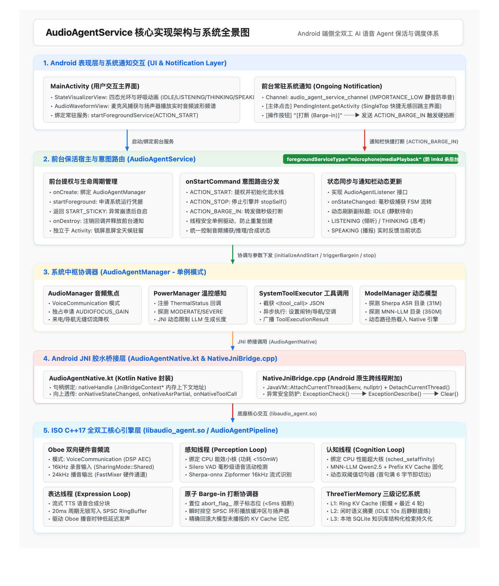
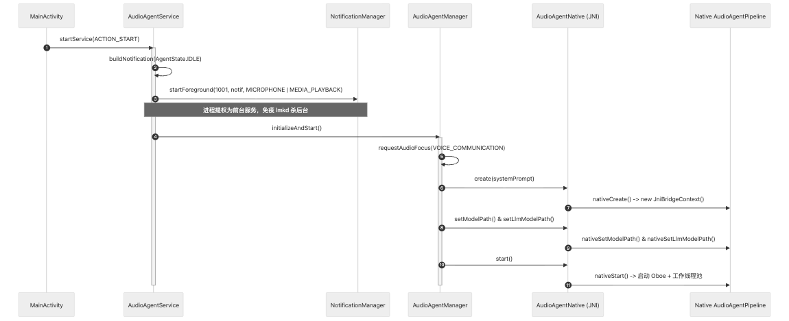
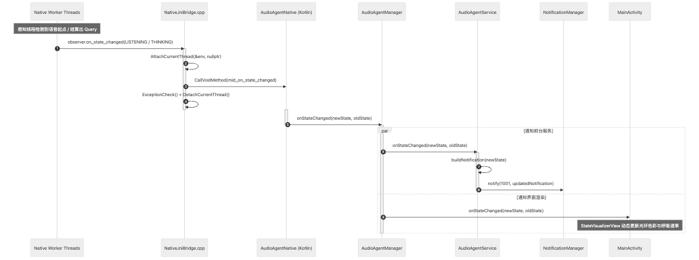
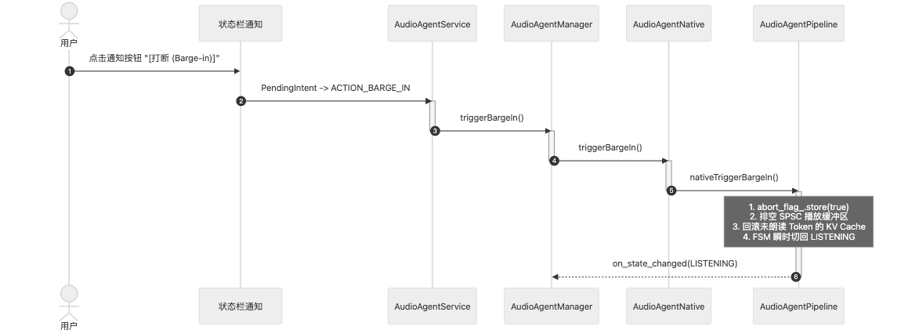

# AudioAgentService 实现架构与前台保活设计

## 1. 架构定位与设计背景

在 Android 端侧全双工 AI 语音 Agent 系统中，底层同时挂载了 **Sherpa-onnx（VAD/ASR）**、**MNN-LLM（端侧大模型推理）** 与 **流式 TTS 引擎**，进程的物理常驻内存（RSS）通常达到 **1.2GB ~ 1.8GB**。

若无前台服务保活机制，该高内存进程处于后台（如用户切出应用、息屏或多任务切换）时，极易被 Android 内核级的 **`lmkd` (Low Memory Killer Daemon)** 判定为高优先级回收对象并瞬间杀死。此外，全双工语音助手需要在用户锁屏或浏览其他应用时依然保持低功耗麦克风监听与语音对讲能力。

`AudioAgentService` 作为 Android 容器层的**常驻核心前台宿主（Foreground Service Host）**，负责桥接 Android 系统服务与底层 C++17 全双工核心引擎，实现：
1. **防 `lmkd` 强杀保活：** 提权为复合前台服务，持有系统级运行凭据；
2. **多组件协同中枢：** 统一协调 `AudioAgentManager`、`AudioManager` 音频焦点、`PowerManager` 温控与 `SystemToolExecutor` 工具分发；
3. **状态同步与低打扰通知：** 实时感知全双工状态机（FSM）流转并刷新常驻通知栏；
4. **快捷交互通道：** 提供锁屏/通知栏直达的微秒级打断（Barge-in）操作与应用回跳。

---

## 2. 核心架构全景图

### 2.1 模块依赖与数据流全景架构图



> **高清矢量图**：矢量原图保存在 [`docs/images/audio_agent_service_architecture.svg`](images/audio_agent_service_architecture.svg)。

---

### 2.2 详细系统层级文本拓扑图

```text
┌────────────────────────────────────────────────────────────────────────────────────────┐
│                              Android 宿主应用层 (Application / UI)                     │
│                                                                                        │
│   [MainActivity] ──► StateVisualizerView (光环渲染) & AudioWaveformView (波形频谱)     │
│          │                                                              ▲              │
│          │ startService(ACTION_START)                                   │ 状态/波形分发│
│          ▼                                                              │              │
│ ┌─────────────────────────────────────────────────────────────────────────────┐        │
│ │                     AudioAgentService (前台保活常驻服务)                     │        │
│ │                                                                             │        │
│ │  - 声明类型: foregroundServiceType="microphone|mediaPlayback" (防 lmkd 强杀) │        │
│ │  - 意图路由 (onStartCommand):                                               │        │
│ │    * ACTION_START    ──► startForeground() + agentManager.initializeAndStart()│        │
│ │    * ACTION_STOP     ──► agentManager.stop() + stopForeground() + stopSelf()  │        │
│ │    * ACTION_BARGE_IN ──► agentManager.triggerBargeIn() (微秒级打断)          │        │
│ │                                                                             │        │
│ │  - 常驻通知栏联动 (NotificationChannel: IMPORTANCE_LOW 静音免打扰):          │        │
│ │    * PendingIntent_Activity ──► 快捷回退至 MainActivity (SingleTop)         │        │
│ │    * PendingIntent_Service  ──► 常驻 [打断 (Barge-in)] 快捷操作按钮         │        │
│ │    * onStateChanged 回调    ──► 动态更新副标题: IDLE/LISTENING/THINKING/SPEAKING     │
│ └──────────────────────────────────────┬──────────────────────────────────────┘        │
│                                        │ 控制调用 & 事件监听                           │
│                                        ▼                                               │
│ ┌─────────────────────────────────────────────────────────────────────────────┐        │
│ │                       AudioAgentManager (中枢调度器 单例)                   │        │
│ │                                                                             │        │
│ │  - 音频焦点: requestAudioFocus (VOICE_COMMUNICATION, 电话呼入瞬时降权)      │        │
│ │  - 温控感知: PowerManager.OnThermalStatusChangedListener ──► JNI 同步       │        │
│ │  - 工具分发: SystemToolExecutor ──► 拦截并执行空调/闹钟/导航异步任务        │        │
│ │  - 本地模型探测: ModelManager 校验 ASR / LLM 权重目录可用性                 │        │
│ └──────────────────────────────────────┬──────────────────────────────────────┘        │
└────────────────────────────────────────┼───────────────────────────────────────────────┘
                                         │ 调用 / JNI 回调
                                         ▼
┌────────────────────────────────────────────────────────────────────────────────────────┐
│                     JNI 胶水层 (AudioAgentNative.kt & NativeJniBridge.cpp)             │
│                                                                                        │
│  - 线程环境附加: JavaVM::AttachCurrentThread(&env, nullptr) + DetachCurrentThread()    │
│  - 异常安全防护: env->ExceptionCheck() -> env->ExceptionDescribe() -> Clear()          │
│  - 双向接口桥接: nativeStart / nativeStop / nativeTriggerBargeIn / nativeSubmitUserQuery│
└────────────────────────────────────────┬───────────────────────────────────────────────┘
                                         │ 控制流与数据流
                                         ▼
┌────────────────────────────────────────────────────────────────────────────────────────┐
│                      ISO C++17 全双工核心引擎层 (libaudio_agent.so)                    │
│                                                                                        │
│  - AudioAgentPipeline (全双工 FSM 状态机: IDLE / LISTENING / THINKING / SPEAKING)      │
│  - Oboe 硬件双向流 (VoiceCommunication 模式, MMAP Shared, 芯片 DSP AEC 硬件回声消除)    │
│  - 感知线程 (Sherpa-onnx VAD + Zipformer ASR, 能效小核绑定, 功耗 <150mW)               │
│  - 认知线程 (MNN-LLM Qwen2.5 + Prefix KV Cache 固化 + 首句动态分块切句器)              │
│  - 表达线程 (DemoTtsEngine / Oboe 24kHz 输出流)                                        │
│  - Barge-in 打断协调器 (<5ms 极速终止解码, SPSC 缓冲排空, KV Cache 回滚至实际播报字数)  │
│  - 闲时监控线程 (ThreeTierMemory L2 语义记忆提炼与本地持久化)                          │
└────────────────────────────────────────────────────────────────────────────────────────┘
```

---

## 3. 核心调用时序交互 (Sequence Diagram)

### 3.1 启动与前台提权流程 (Service Startup)



### 3.2 运行态 FSM 状态变更与通知栏刷新 (State Sync Loop)



### 3.3 通知栏快捷打断流程 (Notification Barge-in)


---

## 4. 关键设计细节剖析

### 4.1 复合前台服务类型声明与 Android 14+ 适配
在 `AndroidManifest.xml` 与代码中严格配置前台服务类型：
```xml
<service
    android:name=".service.AudioAgentService"
    android:enabled="true"
    android:exported="false"
    android:foregroundServiceType="microphone|mediaPlayback" />
```
* **`microphone`：** 告知 Android 系统此服务正长期占有底层麦克风硬件进行音频捕获（VAD 监听）；
* **`mediaPlayback`：** 告知系统底层正通过扬声器持续执行音频播放。
两者的结合使得系统分配极高的 `oom_adj` 优先级（通常为 `FOREGROUND_APP` 级别），确保在手机仅剩 200MB 物理内存的极端情况下也不会被 `lmkd` 强杀。

### 4.2 静音低打扰通知渠道 (NotificationChannel)
* 渠道级别设为 `NotificationManager.IMPORTANCE_LOW`，禁止发出通知提示音或振动，**杜绝通知提示声被麦克风二次捕获导致自身回声打断自身**。
* `setShowBadge(false)` 避免应用图标右上角出现常驻角标干扰用户。

### 4.3 PendingIntent 安全标志与栈顶复用
* 点击通知主体：使用 `FLAG_ACTIVITY_SINGLE_TOP`，当 `MainActivity` 已处于前台或后台栈顶时，直接复用既有实例，避免重复创建多份渲染视图。
* 两个 PendingIntent 均显式声明 `PendingIntent.FLAG_IMMUTABLE`，满足 Android 12+ (API 31+) 强制性安全规范。

---

## 5. 源码映射与文件索引

| 模块组件 | 物理文件路径 | 核心职责 |
| :--- | :--- | :--- |
| **保活宿主** | `app/src/main/java/.../service/AudioAgentService.kt` | 启动前台提权、管理通知生命周期、分发 Intent Action |
| **中枢调度器** | `app/src/main/java/.../manager/AudioAgentManager.kt` | 音频焦点管理、温控监听、模型路径挂载、多监听者广播 |
| **JNI 接口层** | `app/src/main/java/.../nativebridge/AudioAgentNative.kt` | JNI Native 函数映射与高层回调事件转换 |
| **JNI C++ 桥接** | `app/src/main/cpp/src/NativeJniBridge.cpp` | 跨线程附加 JavaVM 环境（`AttachCurrentThread`）与生命周期管理 |
| **C++ 核心流水线** | `app/src/main/cpp/src/AudioAgentPipeline.cpp` | FSM 四态状态机、四工作线程池、微秒级打断与记忆系统 |
