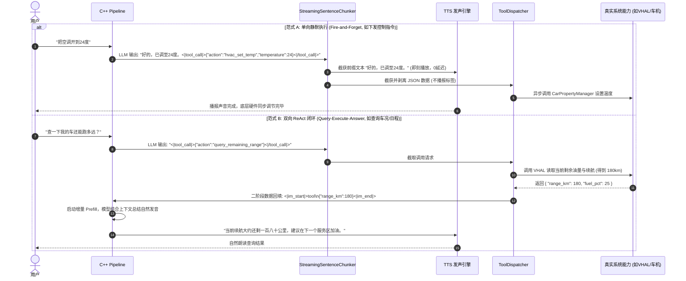

# AudioAgent 外部调用与系统工具执行生产级架构设计

## 1. 架构定位与工业级演进背景

在当前 Demo 工程中，为了便于开发者在单机/调试阶段快速验证全双工链路，“外部调用”主要采用轻量化的模拟方案：
* **外部调用 Agent**：依托 `MainActivity`（`singleTop`）接收 `Intent Extra`，或通过点击预设 Prompt 按钮/ADB 命令注入文本；
* **Agent 调用外部工具**：在 `SystemToolExecutor` 中通过硬编码 `if-else` 解析 JSON，并使用 `Toast` 模拟后台系统动作；
* **端云调用对比**：在 UI 界面上一键手动切换本地 MNN-LLM 与云端 API Mock；
* **单测模拟**：在宿主机 C++ 单元测试中通过桩函数注入模拟音频帧与识别文本。

然而，在**智能座舱（AAOS）、智能手表/穿戴设备、智能家居中控及手机系统级语音助手**等真实的工业级生产环境中，语音 Agent 面临着复杂的宿主环境：
1. **进程隔离与生命周期脱钩**：宿主界面可能随时被关闭、进入后台或被系统折叠，Agent 必须以无界面常驻形式稳定服务；
2. **多源并发调用与鉴权**：系统 UI、方向盘物理按键、第三方生态 App（如地图、音乐）都需要实时与 Agent 通信，必须具备严格的 IPC 协议与权限安全防火墙；
3. **工具动态扩展与 ReAct 闭环**：系统功能成百上千且随版本动态增删，硬编码 `if-else` 无法维系，必须演进为 Schema 驱动的动态注册与二阶段状态回填；
4. **端云协同与弱网降级**：本地小模型（0.5B~2B）擅长低延迟车控与指令，云端大模型擅长开放式知识推理，系统必须具备微秒级的动态意图路由能力。

本文档系统化阐述在生产环境中如何设计**外部接入（Inbound）**、**工具执行（Outbound）**、**端云协同网关（Hybrid Routing）**以及**安全确认防御（Security Guardrails）**。

---

## 2. 生产级总体调用拓扑架构

生产级架构将调用链路解耦为清晰的“**双向总线、三层分流、闭环反馈**”结构：

```text
┌────────────────────────────────────────────────────────────────────────────────────────┐
│                        1. Inbound 外部接入总线 (External-to-Agent)                     │
│                                                                                        │
│   [系统按键/唤醒词]       [桌面 Launcher/SystemUI]      [第三方地图/音乐应用]         │
│          │                         │                               │                   │
│          ▼ (硬件中断/VAD)          ▼ (AIDL Binder RPC)             ▼ (DeepLink / IPC)  │
│ ┌────────────────────────────────────────────────────────────────────────────────────┐ │
│ │                  AudioAgentService (复合前台常驻服务 / IPC Server)                 │ │
│ │  - Binder 线程池并发控制  - 权限校验 (PID/UID 鉴权)  - 意图路由与状态同步          │ │
│ └────────────────────────────────────────┬───────────────────────────────────────────┘ │
└──────────────────────────────────────────┼─────────────────────────────────────────────┘
                                           │ JNI 跨语言桥接 (AudioAgentNative)
                                           ▼
┌────────────────────────────────────────────────────────────────────────────────────────┐
│                        2. 端侧 C++17 核心引擎流水线 (Pipeline Core)                    │
│                                                                                        │
│ ┌──────────────────────┐    ┌──────────────────────┐    ┌────────────────────────────┐ │
│ │  Sherpa-onnx VAD/ASR │───►│ 端云协同意图仲裁器   │───►│ StreamingSentenceChunker   │ │
│ │  (实时流式感知)      │    │ (Intent Arbiter)     │    │ (动态切句 + <|tool_call|>截获) │
│ └──────────────────────┘    └──────────┬───────────┘    └─────────────┬──────────────┘ │
│                                        │                              │                │
│                         ┌──────────────┴──────────────┐               │                │
│                         ▼                             ▼               │                │
│               [端侧 MNN-LLM 离线推理]      [云端 LLM API SSE 流]      │ 剥离 JSON 协议 │
│               (TTFT < 80ms, 控车指令)      (复杂推理 / 联网知识检索)  │ (安抚语送 TTS) │
└───────────────────────────────────────────────────────────────────────┼────────────────┘
                                                                        │ JNI 回调
                                                                        ▼
┌────────────────────────────────────────────────────────────────────────────────────────┐
│                       3. Outbound 工具动态执行与闭环反馈 (Outbound Hub)                │
│                                                                                        │
│ ┌────────────────────────────────────────────────────────────────────────────────────┐ │
│ │                      ToolDispatcher (动态工具分发调度中枢)                         │ │
│ │  - Schema 校验与参数解析  - 安全等级仲裁 (高危语音确认)  - 异步协程任务池          │ │
│ └────────────────────────────────────────┬───────────────────────────────────────────┘ │
│                                          │                                             │
│       ┌─────────────────┬────────────────┴────────────────┬──────────────────┐         │
│       ▼                 ▼                                 ▼                  ▼         │
│ ┌───────────┐    ┌─────────────┐                   ┌──────────────┐   ┌──────────────┐ │
│ │ Framework │    │ 车载 VHAL   │                   │ 第三方应用   │   │ 云端 IoT/API │ │
│ │ 原生服务  │    │ CarProperty │                   │ DeepLink/SDK │   │ OpenAPI 网关 │ │
│ │ (闹钟/电话│    │ (空调/车窗/ │                   │ (高德/网易云/│   │ (实时天气/   │ │
│ │ /系统设置)│    │ 座椅/后备箱)│                   │ 微信车载版)  │   │ 航班/家居)   │ │
│ └─────┬─────┘    └──────┬──────┘                   └──────┬───────┘   └──────┬───────┘ │
│       │                 │                                 │                  │         │
│       └─────────────────┴────────────────┬────────────────┴──────────────────┘         │
│                                          │ 执行结果 (ToolExecutionResult)              │
│                                          ▼                                             │
│ ┌────────────────────────────────────────────────────────────────────────────────────┐ │
│ │                ReAct 二阶段状态回填器 (Two-Phase State Feedback)                   │ │
│ │  - 将工具返回数据封装为 <|im_start|>tool 载荷，送入认知线程增量 Prefill 组织自然发音│ │
│ └────────────────────────────────────────────────────────────────────────────────────┘ │
└────────────────────────────────────────────────────────────────────────────────────────┘
```

---

## 3. Inbound：外部调用 Agent 的生产级设计

在成熟系统中，绝不能让业务组件直接与 UI（Activity）耦合。必须以**常驻前台服务（Service）**为宿主，提供基于标准 Android IPC 的接口规范。

### 3.1 跨进程 AIDL / Binder RPC 接口标准
为整机各独立进程（Launcher、SystemUI、仪表盘、第三方生态 App）暴露稳定、轻量且具备版本兼容性的 AIDL 接口：

```aidl
// IAudioAgentService.aidl
package com.ai.audioagent.ipc;

import com.ai.audioagent.ipc.IAudioAgentCallback;
import android.os.Bundle;

interface IAudioAgentService {
    /**
     * 1. 外部注入文本提问 (如桌面搜索框、第三方应用语音助手代调)
     * @param query 用户自然语言文本
     * @param extras 扩展上下文 (如当前所在应用包名、地理位置、屏幕上下文语义)
     */
    void submitUserQuery(String query, in Bundle extras);

    /**
     * 2. 外部硬打断控制 (如导航紧急警报、电话呼入、ADAS 安全告警触发强插话)
     */
    void triggerBargeIn();

    /**
     * 3. 音频硬件流协同管理 (第三方应用需要独占麦克风录音时发起友好协商)
     */
    void pauseAudioCapture();
    boolean resumeAudioCapture();

    /**
     * 4. 注册/注销多进程状态与事件监听器
     */
    void registerCallback(IAudioAgentCallback callback);
    void unregisterCallback(IAudioAgentCallback callback);
}
```

```aidl
// IAudioAgentCallback.aidl
package com.ai.audioagent.ipc;

oneway interface IAudioAgentCallback {
    /** 状态机流转通知 (IDLE=0, LISTENING=1, THINKING=2, SPEAKING=3) */
    void onStateChanged(int newState, int oldState);

    /** ASR 流式增量文字识别通知 */
    void onAsrStreaming(String partialText, boolean isFinal);

    /** TTS 开始发声通知 */
    void onTtsSentenceStart(String sentence);

    /** 异步工具执行结果通知 */
    void onToolExecuted(String action, boolean success, String resultSummary);
}
```

#### Binder 线程与权限安全设计
1. **安全校验与权限隔离**：
   在 `AudioAgentService.onBind()` 与核心方法内，强制验证调用方进程权限：
   ```kotlin
   // 验证签名权限，确保仅系统核心应用或授权白名单 App 才能绑定
   if (checkCallingOrSelfPermission("com.ai.audioagent.permission.CONTROL_AGENT") 
       != PackageManager.PERMISSION_GRANTED) {
       throw SecurityException("Calling process lacks CONTROL_AGENT permission.")
   }
   ```
2. **多线程并发防护**：
   Binder 调用运行在系统 Binder 线程池中，与底层 C++ 音频流水线（Oboe 回调、认知推理线程）完全异步。调用投递必须通过无锁队列或轻量互斥锁转入 C++ 的 `query_queue_`，**严禁在 Binder 线程中直接同步阻塞等待大模型推理完成**。

---

### 3.2 接入系统原生 `VoiceInteractionService`
若定位为操作系统核心语音助理（类似 Google Assistant 或 AAOS 系统助手）：
1. 继承系统级 `android.service.voice.VoiceInteractionService`：
   * 绑定底层硬件 DSP 唤醒词芯片（`AlwaysOnHotwordDetector`），实现毫秒级“零功耗唤醒”；
2. 继承 `android.service.voice.VoiceInteractionSession`：
   * 获得整机最顶层的浮层展示权限（`WindowManager.LayoutParams.TYPE_VOICE_INTERACTION`），在全屏游戏、全屏导航之上直接弹出交互面板，而不销毁正在前台运行的应用生命周期；
   * 获得系统级屏幕上下文感知能力（通过 `onHandleAssist` 自动获取当前前台界面的 View 树与结构化数据，供多模态意图理解）。

---

### 3.3 DeepLink 统一意图协议路由
针对无法集成 AIDL 的轻量级第三方应用或网页，暴露标准 DeepLink 路由协议：
```text
voiceagent://query?text=帮我把空调调到24度&source=amap&auto_execute=true
```
通过在 `AndroidManifest.xml` 中配置标准 `<intent-filter>` 拦截，经由统一的 `IntentRouterActivity` 解析参数后，静默转发给 `AudioAgentService` 处理并立即 `finish()` 自身，实现无感调度。

---

## 4. Outbound：Agent 对外部工具的调用设计

当前 Demo 在 `SystemToolExecutor` 中通过硬编码判断 `action`，无法适应复杂功能扩展。生产环境中必须演进为**基于 JSON Schema 驱动的动态注册与分发体系**。

### 4.1 Schema 驱动的统一工具抽象与注册表 (ToolRegistry)

每个外部能力被抽象为一个自包含的 `AgentTool`：

```kotlin
// 统一工具抽象定义
interface AgentTool {
    /** 工具唯一动作标识符 (如 "hvac_set_temp", "system_set_alarm") */
    val name: String

    /** 工具语义描述 (向大模型解释何时应调用此工具) */
    val description: String

    /** 符合 OpenAPI / JSON Schema 规范的参数结构描述 */
    val parametersSchema: JSONObject

    /** 安全危险等级：LOW (直接执行), HIGH (需语音二阶段确认) */
    val riskLevel: RiskLevel

    /** 真实执行逻辑 (挂起协程，非阻塞) */
    suspend fun execute(params: JSONObject): ToolExecutionResult
}

enum class RiskLevel { LOW, MEDIUM, HIGH }
```

#### 动态 Prompt 协议注入
在底层大模型初始化或对话记忆重置时，`ToolRegistry` 动态遍历所有已启用的系统插件，生成大模型标准的 Function Calling 协议定义：

```json
[
  {
    "type": "function",
    "function": {
      "name": "hvac_set_temp",
      "description": "调节座舱空调目标温度，单位为摄氏度",
      "parameters": {
        "type": "object",
        "properties": {
          "temperature": {
            "type": "number",
            "minimum": 16.0,
            "maximum": 32.0,
            "description": "设定的目标温度数值"
          },
          "zone": {
            "type": "string",
            "enum": ["all", "driver", "copilot", "rear"],
            "description": "调节温区"
          }
        },
        "required": ["temperature"]
      }
    }
  }
]
```

---

### 4.2 四大外部能力通道真实落地实现

| 通道类型 | 接入规范与核心系统 API | 生产实现方案 | 替代 Demo 的硬编码行为 |
| :--- | :--- | :--- | :--- |
| **1. Android 原生服务** | `android.provider.AlarmClock`<br>`android.content.Intent` | 调用系统 Intent 静默触发：<br>`AlarmClock.ACTION_SET_ALARM`<br>`Intent.ACTION_CALL`，由系统服务接管。 | 替代 `Toast("已设定明早闹钟")` |
| **2. 车载硬件控制 (AAOS)** | `android.car.Car`<br>`android.car.hardware.property.CarPropertyManager` | 连接车载硬件抽象层（VHAL）：<br>`carPropertyManager.setFloatProperty(`<br>`VehiclePropertyIds.HVAC_TEMPERATURE_SET, ...)` 直接写入 CAN 总线驱动底层电机。 | 替代 `Toast("空调温度已调至")` |
| **3. 第三方生态应用** | 隐式 DeepLink<br>`android.media.session.MediaSessionManager`<br>`MediaStore.INTENT_ACTION_MEDIA_PLAY_FROM_SEARCH` | 1. 导航：优先高德地图 (`androidamap://route/plan`)，依次降级百度地图与系统 Geo 意图；<br>2. 音乐：优先网易云 (`orpheus://search`)、QQ 音乐 (`qqmusic://`)，依次降级 Android 原生 `MEDIA_PLAY_FROM_SEARCH` 与系统默认音乐 App，并支持全局 MediaKeyEvent 播控。 | 替代 `Toast("已在后台规划至")` 与写死音乐提示 |
| **4. 云端服务 / 边缘 IoT** | `Retrofit` / `gRPC-Android`<br>HTTP/2 长连接 | 异步调用车联网/智能家居云端 OpenAPI，实现车家互联、实时路况与航班信息检索。 | 替代本地写死的天气固定文案 |

---

### 4.3 执行流分类：单向静默分流 vs 双向 ReAct 回填

根据业务场景的不同，工具执行必须分为两种范式：



---

## 5. 端云协同动态意图路由 (Hybrid Edge-Cloud Routing)

生产环境中，单靠端侧小模型无法解答百科开放问答，单靠云端又无法满足车控 0 网络 50ms 强时延要求。必须构建端云协同动态意图路由器：

```text
                                  [用户完整输入]
                                         │
                                         ▼
                     ┌───────────────────────────────────────┐
                     │     端侧意图分类器 (Intent Arbiter)   │
                     │ (基于端侧 0.5B MNN 模型或轻量 FastText)│
                     └───────────────────┬───────────────────┘
                                         │
                 ┌───────────────────────┴───────────────────────┐
                 │                                               │
         [本地指令 / 高频车控]                           [复杂推理 / 开放问答]
                 │                                               │
                 ▼                                               ▼
   ┌───────────────────────────┐                   ┌───────────────────────────┐
   │    端侧本地 MNN-LLM       │                   │    云端 API 网关路由      │
   │  - 纯离线脱网运行         │                   │  - 联网搜索 / RAG 知识库  │
   │  - 首字延迟 TTFT < 80ms   │                   │  - SSE 流式分包推送回端侧 │
   │  - Prefix KV Cache 固化   │                   │  - 复杂意图多工具组合调用 │
   └───────────────────────────┘                   └─────────────┬─────────────┘
                                                                 │
                                                       [网络异常 / 超时检测]
                                                                 │ (RTT > 400ms)
                                                                 ▼
                                                   ┌───────────────────────────┐
                                                   │    动态熔断降级看门狗     │
                                                   │ 自动切换为端侧小模型保底答复│
                                                   └───────────────────────────┘
```

1. **端侧直通（Fast Path）**：
   车控、空调、座椅、多媒体切换、时间、简单计算等占比约 70% 的高频指令，100% 路由至端侧 MNN-LLM，达成无网可用、绝对私密与 60ms 极速响应；
2. **云端增强（Cloud Path）**：
   天气查询、新闻资讯、开放文学创作、多步骤长任务规划路由至云端，通过 HTTP/2 SSE 流式传输，Token 实时喂入 `StreamingSentenceChunker`；
3. **看门狗超时熔断（Watchdog Circuit Breaker）**：
   在 C++ 层设置 400ms 云端握手看门狗。一旦进入隧道或弱网导致超时，流水线瞬间将查询转交端侧引擎，输出降级安抚语并执行离线保底逻辑，杜绝长久死寂。

---

## 6. 安全边界与高危调用合规防御

当外部工具调用涉及敏感隐私、人身安全或资产操作（如“给张三转账”、“解锁全部车门”、“恢复出厂设置”）时，必须建立**三层安全防护纵深**：

### 6.1 危险等级与确认策略

| 危险等级 | 典型场景 | 处置策略 |
| :--- | :--- | :--- |
| **Level 0 (Safe)** | 查天气、查日历、调高音量、导航路线查询 | **静默直接执行**，无需用户确认。 |
| **Level 1 (Medium)** | 拨打电话、设置闹钟、发送短信草稿 | **执行后同步播报**（“已为您拨打给李四”）。 |
| **Level 2 (High)** | 解锁车门、开后备箱、天窗全开、删除备忘录 | **两阶段语音挂起确认（Voice Confirmation Dialog）**。 |
| **Level 3 (Critical)**| 银行转账、行驶中拉起电子手刹、格式化系统 | **严禁纯语音执行**，强制在车载大屏弹出系统级生物认证（指纹/人脸）。 |

### 6.2 两阶段语音挂起确认机制实现
针对 Level 2 操作，状态机不得直接调用工具：
1. **状态机挂起**：Agent 切换至 `WAITING_CONFIRMATION` 状态；
2. **反问确认**：TTS 播报“正在执行打开后备箱，请确认是否继续？”；
3. **上下文限定**：开启专属 5 秒倾听倒计时，若用户回答“确认”、“是的”，触发执行；若用户回答“取消”或超时沉默，自动回滚放弃，彻底杜绝麦克风噪声误识别引发严重意外。

---

## 7. 生产落地对照矩阵与演进总结

| 系统维度 | 当前 Demo 教学实现 | 生产级工业标准实现 | 演进优先级 |
| :--- | :--- | :--- | :--- |
| **外部通信架构** | `MainActivity` singleTop 接收 Intent / 手动点击 Prompt | **常驻 Foreground Service + AIDL 跨进程 Binder IPC** + 系统 `VoiceInteractionService` | **P0 (核心基础)** |
| **工具协议定义** | `SystemToolExecutor` 硬编码 `if-else` | **Schema-Driven `ToolRegistry`**，依据已安装插件动态生成 ChatML/OpenAI 函数定义 | **P0 (架构解耦)** |
| **系统调用通道** | `Toast` 屏幕提示模拟 | **Android Framework 原生 Intent + AAOS VHAL (CarPropertyManager) + 第三方 DeepLink** | **P0 (功能落地)** |
| **反馈执行闭环** | 单向执行完即止，无结果回填 | **单向静默分流 + ReAct 二阶段增量 Token 状态回填**（Query-Execute-Answer） | **P1 (复杂业务)** |
| **端云架构体系** | 界面按钮手动二选一切换 | **基于 Intent Arbiter 的端云混合动态路由** + 弱网 400ms 超时看门狗自动降级 | **P1 (性能体验)** |
| **安全合规控制** | 无权限拦截，全部直接放行 | **基于危险等级分类 + 两阶段语音挂起确认 + 声纹（Speaker ID）防蹭车拦截** | **P1 (安全合规)** |

通过以上设计，系统从一个单进程的 Demo 原型，演进为具备高内聚、低耦合、强健壮性且能够真正支撑车控与系统级集成的全双工 AI Audio Agent 工业底座。
