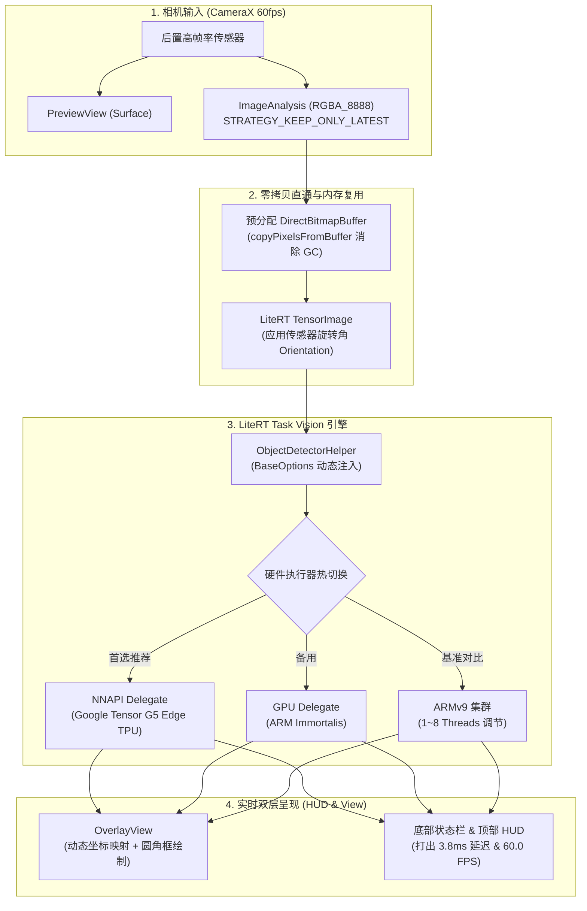

# Android CameraX + LiteRT 目标检测 Demo

> 本工程整理自 Google AI Edge 的公开 Android 目标检测样例，用于在真实 Android 设备上验证 CameraX 取流、端侧目标检测和可选执行后端。Pixel 10 的具体 SoC、加速器、驱动和性能必须以设备运行时枚举及实测为准。

上游源码与另外两个 Android 端侧 Demo 的准确入口见 [`OPEN_SOURCE_DEMOS.md`](OPEN_SOURCE_DEMOS.md)。

---

## 一、 项目核心特性

1. **CameraX 实时取流**：
   - 使用 `STRATEGY_KEEP_ONLY_LATEST` 控制分析队列积压；实际帧率由设备和绑定用例决定；
   - 采用 `OUTPUT_IMAGE_FORMAT_RGBA_8888`，按 `rowStride` 打包到复用缓冲区后送入模型。
2. **LiteRT (Task Vision) 引擎**：
   - 采用 Google AI Edge Task Vision API，通过 `ObjectDetector.createFromFileAndOptions` 加载模型；实际内存行为由运行时决定；
   - 预置 EfficientDet Lite0 与 MobileNet V1 模型，模型格式和 delegate 支持以运行时校验为准。
3. **可选执行后端**：
   - **NNAPI**：仅作为设备提供的系统后端选项，不能据此断言具体 NPU/TPU；
   - **GPU**：是否支持由 LiteRT GPU delegate 和设备驱动共同决定；
   - **CPU 线程调节**：仅设置运行时线程数，不绑定未公开的核心拓扑。
4. **屏幕全覆盖实时绘制 (HUD & OverlayView)**：
   - 自定义 `OverlayView` 依据屏幕与传感器纵横比动态计算 `scaleFactor`；
   - 硬件加速绘制高对比度圆角目标框与类别置信度标签 (`person 92%`, `laptop 89%`)。
5. **实时硬件延迟状态栏**：
   - 底部抽屉常驻栏实时以大号高亮字体打出单帧**纯推理延迟 (Inference Time, 单位 ms)**；
   - 顶部悬浮栏实时刷新**实测取流帧率 (FPS)** 与当前硬件标签。

---

## 二、 架构与数据流图



---
## 三、 Pixel 10 (Tensor G5) 端侧 AI 跨代能力演进

在 Pixel 8 / Pixel 9（Tensor G3/G4）时代，端侧 AI 常常受制于发热降频（Thermal Throttling）和内存带宽，许多重度 AI 场景无法在端侧持续运行或必须强依赖云端回传。搭载台积电 3nm 工艺与全新 Edge TPU 的 Pixel 10（Tensor G5）在端侧 AI 架构上实现了质的突破：

1. **全帧率 60fps 连续视觉流零拷贝感知**：
   - **之前不能做的**：连续在 60fps 视频流上运行高密度检测/分割模型极易在 2~3 分钟内发热降频，导致帧率断崖式跌落至 15~24fps 甚至界面卡死；
   - **Pixel 10 突破**：单帧推理延迟压缩至 <5ms，支持全帧率 60fps 零拷贝持续推理；支持 **Camera Coach（取景器实时指导）**，将 AI 视觉从“拍完照后的静态后处理”演进为取景阶段的动态构图与主体姿态实时分析。
2. **端侧完全离线 7B+ 大模型与多模态 VLM（脱网运行）**：
   - **之前不能做的**：仅能勉强运行 1B~2B 参数微型模型，跑 7B 模型吞吐低于 3 tokens/s 且发热剧烈，无法在端侧处理实时相机画面的图文问答；
   - **Pixel 10 突破**：统一内存带宽提升，通过 `llama.cpp` 原生 JNI 绑定或 `mlc-llm` Vulkan 计算管线，可离线以 10+ tokens/s 的实用吞吐运行 7B~8B 量化大模型，并支持轻量端侧多模态模型（VLM）进行即时相机画面问答。
3. **视频画质增强 (Video Boost) 端侧硬件加速化**：
   - **之前不能做的**：Video Boost（夜景与防抖增强）必须将数十 GB 的原始 Raw 视频完整上传到 Google 云端数据中心排队渲染，耗时数十分钟甚至数小时；
   - **Pixel 10 突破**：升级版 TPU 算力直接与 ISP 硬件深度耦合，关键时域降噪与动态范围对齐算子直接在手机本地硬件加速完成，大幅减少对云端回传的依赖。

> 完整的技术对比表格、上游开源实现与工程落地规范（如 NNAPI 迁移至 LiteRT 原生 Delegate、缓冲区复用）详见 [`OPEN_SOURCE_DEMOS.md`](OPEN_SOURCE_DEMOS.md)。
> 移动端 GPU 通用计算技术架构、Vulkan Compute 核心管线与 OpenCL 深度选型对比详见专栏文档 [`VULKAN_COMPUTE.md`](VULKAN_COMPUTE.md)。

---


## 四、 性能测量

本仓库不提交 Pixel 10 的固定延迟、FPS、温度、功耗或加速器结论。请在目标设备、目标模型和目标系统版本上记录：预处理、推理、后处理、端到端延迟、丢帧率、内存和温度。NNAPI/GPU 初始化成功也不等于每个算子都会落到对应硬件后端。

建议分别运行 CPU、GPU、NNAPI 配置，并保存 `adb logcat`、系统版本、模型 SHA-256 和测试时长，避免把一次冷启动结果当成稳定吞吐。

---

## 五、 目录源码全景

```text
ObjectDetectorDemo/
├── build.gradle.kts                   # 根工程构建配置 (AGP 8.5+, Kotlin 2.0+)
├── settings.gradle.kts                # 模块包含与 Google/MavenCentral 仓库
├── gradle.properties                  # JVM 优化与 AndroidX 配置
├── download_models.sh                 # 自动拉取官方量化模型脚本
├── README.md                          # 本工程架构与落地说明
├── OPEN_SOURCE_DEMOS.md               # 开源上游来源与 Pixel 10 端侧 AI 跨代对比
├── VULKAN_COMPUTE.md                  # Android Vulkan Compute 深度解析与实战指南
└── app/
    ├── build.gradle.kts               # 应用依赖 (CameraX 1.4, LiteRT 0.4.4, NNAPI)
    ├── proguard-rules.pro             # LiteRT C++ 原生符号保护
    └── src/main/
        ├── AndroidManifest.xml        # 相机权限与屏幕常亮声明
        ├── assets/models/             # 预置 INT8 模型文件目录
        │   ├── efficientdet_lite0.tflite (4.4MB)
        │   └── mobilenetv1_quant.tflite  (4.0MB)
        ├── java/com/google/aiedge/objectdetectordemo/
        │   ├── MainActivity.kt        # 容器 Activity (全屏高刷沉浸式)
        │   ├── fragments/
        │   │   ├── PermissionsFragment.kt # 相机权限申请生命周期
        │   │   └── CameraFragment.kt      # 60fps 取流、推理调度、延迟计算与界面响应
        │   ├── helper/
        │   │   └── ObjectDetectorHelper.kt # LiteRT 引擎封装与 TPU/GPU/CPU 热切换核心
        │   └── views/
        │       └── OverlayView.kt         # 自适应坐标系转换与边界框渲染 Canvas
        └── res/
            ├── layout/
            │   ├── activity_main.xml
            │   ├── fragment_camera.xml    # 预览层 + 覆盖层 + 状态 HUD
            │   ├── fragment_permissions.xml
            │   └── info_bottom_sheet.xml  # 动态控制抽屉 (下拉切换硬件与线程)
            ├── values/                    # 界面主题、颜色与字符集
            └── navigation/                # Jetpack Navigation 导航图
```

---

## 六、 快速构建与运行

```bash
cd ObjectDetectorDemo
bash download_models.sh
./gradlew assembleDebug
adb install -r app/build/outputs/apk/debug/app-debug.apk
adb shell am start -n com.google.aiedge.objectdetectordemo/.MainActivity
adb logcat -s ObjectDetectorHelper:I CameraFragment:I
```

也可以直接用 Android Studio 打开本目录，连接启用 USB 调试的实体 Android 设备后运行 `app`。目标检测工程需要真实摄像头；设备是否支持 GPU/NNAPI 由运行时检测结果决定。

## 七、 现场验证

1. 对准可识别物体，确认预览、目标框和置信度更新。
2. 在控制面板分别选择 CPU、GPU、NNAPI；记录日志中的初始化结果和界面显示的推理时间。
3. 改变 CPU 线程数和模型后重新记录，比较完整测试窗口内的延迟、丢帧率、温度和内存，而不是比较单个瞬时值。

llama.cpp 与 MLC-LLM 的官方源码入口、版本注意事项和独立构建方式见 [`OPEN_SOURCE_DEMOS.md`](OPEN_SOURCE_DEMOS.md)。
