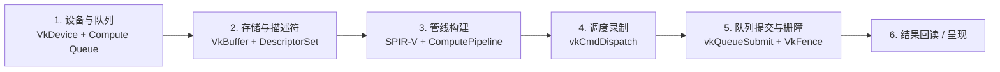
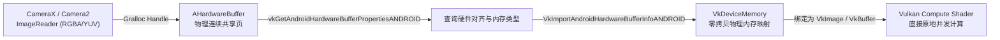

# Android 平台 Vulkan Compute 深度解析与实战指南

> 本文系统梳理 **Vulkan Compute（Vulkan 通用计算）** 在 Android 移动端与边缘计算生态中的工业界应用现状、底层架构、GLSL/SPIR-V 着色器设计、Camera 零拷贝直通机制，以及与 OpenCL 的深度技术选型对比。

---

## 目录

- [一、 工业界落地现状：谁在重度使用 Vulkan Compute？](#一-工业界落地现状谁在重度使用-vulkan-compute)
  - [1. 移动端大语言模型 (LLM / VLM)](#1-移动端大语言模型-llm--vlm)
  - [2. 移动端轻量视觉推理引擎 (NCNN / MNN / LiteRT)](#2-移动端轻量视觉推理引擎-ncnn--mnn--litert)
  - [3. 高端影像与短视频渲染引擎](#3-高端影像与短视频渲染引擎)
- [二、 核心架构：纯计算管线（Compute Pipeline）六步闭环](#二-核心架构纯计算管线compute-pipeline六步闭环)
- [三、 计算着色器设计：GLSL 到 SPIR-V](#三-计算着色器设计glsl-到-spir-v)
  - [1. 基础矩阵乘加 / 图像滤波 Kernel 范例](#1-基础矩阵乘加--图像滤波-kernel-范例)
  - [2. 移动端 GPU 线程层次与 Occupancy 优化](#2-移动端-gpu-线程层次与-occupancy-优化)
  - [3. Subgroup（子群原生通信）加速大模型算子](#3-subgroup子群原生通信加速大模型算子)
- [四、 性能关键：AHardwareBuffer 零拷贝直通管线](#四-性能关键ahardwarebuffer-零拷贝直通管线)
- [五、 技术选型对比：Vulkan Compute vs. OpenCL vs. OpenGL ES](#五-技术选型对比vulkan-compute-vs-opencl-vs-opengl-es)
- [六、 NDK C++ 最小纯计算管线代码范例](#六-ndk-c-最小纯计算管线代码范例)
- [七、 总结与工程选型建议](#七-总结与工程选型建议)

---

## 一、 工业界落地现状：谁在重度使用 Vulkan Compute？

在 Android 生态中，Vulkan Compute 正在从“备选方案”逐步演进为**跨平台统一计算的事实标准**。

### 1. 移动端大语言模型 (LLM / VLM)
* **MLC-LLM (TVM 生态)**：
  * Apache TVM 深度学习编译器的核心移动端后端即为 Vulkan。
  * 将端侧 Llama-3、Gemma-2、Phi-3 等模型的 Dense/GEMM（矩阵乘）、RMSNorm、RoPE、FlashAttention 等算子编译为高度优化的 SPIR-V 字节码。
  * 相比手机 CPU 单纯推理，利用 Vulkan Compute 可在现代 SoC（如高通骁龙 8 Gen 3/4、天玑 9300/9400、Tensor G4/G5）上获得 8~15 倍的 Decode 吞吐提升。
* **llama.cpp (ggml-vulkan)**：
  * 在 Android NDK 上通过 `ggml-vulkan.cpp` 提供完整的 GPU 卸载（Offload）能力。
  * 彻底解决了以前通过 OpenCL 在非标准 Android 设备上找不到 `libOpenCL.so` 驱动导致的 Crash 痛点。

### 2. 移动端轻量视觉推理引擎 (NCNN / MNN / LiteRT)
* **腾讯 NCNN**：
  * 移动端视觉开源库的标杆项目。作者 nihui 团队早年便将 Vulkan 作为跨平台 GPU 计算基石，全面支持 FP16 精度、Packed 内存布局与 Buffer 内存复用，在海量国产 Android 机型上拥有极高的兼容性。
* **阿里 MNN**：
  * 同时维护 OpenCL 与 Vulkan 双后端，在新版本 Android 10+ 机型上优先评估 Vulkan 执行路径。
* **Google LiteRT (TensorFlow Lite)**：
  * 官方正持续重构与推进 Vulkan GPU Delegate，逐步收拢原本分散在 OpenGL ES 和私有 OpenCL 上的碎片化算子。

### 3. 高端影像与短视频渲染引擎
* 字节跳动（剪映 / TikTok）、快手等顶级视频剪辑 App，为了解决相机 4K/60fps 实时预览、复杂语义分割滤镜和多帧降噪带来的主线程卡顿，已逐步将 OpenGL ES 计算管线重构成基于 Vulkan Compute 的**异步计算队列（Async Compute Queue）**，与主渲染流水线无锁并行。

---

## 二、 核心架构：纯计算管线（Compute Pipeline）六步闭环

与传统的图形管线（RenderPass、Framebuffer、顶点装配、光栅化）不同，Vulkan Compute 是纯粹的**数据并行计算状态机**：



1. **设备与队列初始化**：
   * 创建 `VkInstance`，遍历 `vkEnumeratePhysicalDevices`；
   * 查找支持 `VK_QUEUE_COMPUTE_BIT` 的队列族（可选择独立的纯计算队列实现与渲染管线异步重叠执行）；
   * 创建逻辑设备 `VkDevice` 并获取计算队列句柄 `VkQueue`。
2. **内存分配与描述符绑定**：
   * 创建存储缓冲 `VkBuffer`（指定 `VK_BUFFER_USAGE_STORAGE_BUFFER_BIT`）；
   * 分配并绑定 `VkDeviceMemory`（对主机可见或设备私有）；
   * 定义 `VkDescriptorSetLayout`，将 SSBO（Shader Storage Buffer Object）关联到特定的着色器绑定槽点（Binding Slot）。
3. **加载 SPIR-V 与构建管线**：
   * 将离线编译好的 SPIR-V 二进制字节码载入 `VkShaderModule`；
   * 填充 `VkComputePipelineCreateInfo`，创建无状态的 `VkPipeline`。
4. **命令录制与分发调度**：
   * 在 `VkCommandBuffer` 中绑定管线 `vkCmdBindPipeline` 和数据描述符 `vkCmdBindDescriptorSets`；
   * 调用 `vkCmdDispatch(cmd, groupCountX, groupCountY, groupCountZ)` 发起线程网格调度。
5. **提交执行与栅障同步**：
   * `vkQueueSubmit` 将计算任务送入硬件执行队列；
   * 使用 `VkFence` 阻塞等待 CPU 回读，或使用 `VkSemaphore` / `VkMemoryBarrier` 进行 GPU 内流水线阶段间的数据同步。

---

## 三、 计算着色器设计：GLSL 到 SPIR-V

Vulkan Compute 内核代码通常采用 GLSL 语法编写（扩展名 `.comp`），并通过 `glslangValidator` 或 Google NDK 内置的 `shaderc` 离线编译为平台无关的 SPIR-V 字节码文件。

### 1. 基础矩阵乘加 / 图像滤波 Kernel 范例

```glsl
#version 450
// 声明工作组尺寸：16 x 16 = 256 线程并发
layout(local_size_x = 16, local_size_y = 16, local_size_z = 1) in;

// 绑定输入与输出的底层连续数据缓存
layout(std430, binding = 0) readonly buffer InputBufferA {
    float a[];
};
layout(std430, binding = 1) readonly buffer InputBufferB {
    float b[];
};
layout(std430, binding = 2) writeonly buffer OutputBufferC {
    float c[];
};

// 使用 Push Constants 传递运行时动态参数（零显存分配开销）
layout(push_constant) uniform PushConstants {
    uint width;
    uint height;
} params;

void main() {
    uint gx = gl_GlobalInvocationID.x;
    uint gy = gl_GlobalInvocationID.y;

    // 边界条件防御
    if (gx >= params.width || gy >= params.height) {
        return;
    }

    uint index = gy * params.width + gx;
    
    // 基础运算逻辑（支持 IEEE 754 浮点及 fp16 混合精度）
    c[index] = a[index] * b[index] + 0.5f;
}
```

### 2. 移动端 GPU 线程层次与 Occupancy 优化

* **WorkGroup（工作组）**：由 `local_size_x, y, z` 显式定义。组内线程可共享局部内存（Shared Memory / Workgroup Memory），并通过 `barrier()` 保持内存一致。
* **硬件执行单元对齐**：
  * 高通 Adreno：Wavefront 宽度通常为 64 或 128；
  * ARM Mali / Immortalis：Warp 宽度通常为 16 或 32。
  * **工程经验**：将单工作组的总线程数控制在 **64、128 或 256**，能最大化激活移动 GPU 流处理器的执行占用率（Occupancy）。

### 3. Subgroup（子群原生通信）加速大模型算子
自 Vulkan 1.1 / Android 10 起引入的 `VK_KHR_shader_subgroup_basic` / `VK_KHR_shader_subgroup_arithmetic` 扩展：
* 允许属于同一个硬件 Wavefront/Warp 的线程直接通过寄存器洗牌指令进行数据交换（`subgroupAdd`、`subgroupBroadcast`）；
* 在大模型矩阵乘（GEMV）和 Softmax 归一化时，**无需回写 Local Shared Memory，直接在寄存器完成归约计算**，延迟降低 40% 以上。

---

## 四、 性能关键：AHardwareBuffer 零拷贝直通管线

在实时端侧视觉与 AI（如 CameraX 60fps 场景）中，传统的内存搬运流程是严重的性能瓶颈：

```
[传统高延迟流程]:
Camera (ISP) ──> CPU Buffer (Java/Native) ──> [显存拷贝: memcpy/vkBufferSubData] ──> GPU 显存
(每次流转带来数毫秒延迟与剧烈发热，无法长时间维持 60fps)
```

通过 Android 专有扩展 `VK_ANDROID_external_memory_android_hardware_buffer`，可以实现真正的硬件级**零拷贝（Zero-Copy）直通**：



1. **Camera 端**：将 `ImageReader` 分配标志设为 `USAGE_GPU_SAMPLED_IMAGE | USAGE_GPU_STORAGE_IMAGE`；
2. **Native 绑定**：
   * 获取底层 `AHardwareBuffer*` 指针；
   * 通过 `vkGetAndroidHardwareBufferPropertiesANDROID` 探测对应的 `memoryTypeBits`；
   * 填充 `VkImportAndroidHardwareBufferInfoANDROID`，将系统物理内存句柄直接导入为 `VkDeviceMemory`；
3. **原地运算**：Compute Shader 直接把这块内存视作 Storage Buffer 或 Storage Image 启动原地滤波或卷积预处理，**无任何冗余数据拷贝**。

---

## 五、 技术选型对比：Vulkan Compute vs. OpenCL vs. OpenGL ES

| 对比维度 | Vulkan Compute | OpenCL | OpenGL ES (Compute) |
|---|---|---|---|
| **Android 平台地位** | **官方一等公民**（NDK 标准链接库，CTS 强制测试） | **非官方实现**（无公共头文件，厂商私有 `.so`） | 官方老旧标准（维护状态，正逐步淘汰） |
| **设备兼容性与稳定性** | Android 10+ 机型极度统一，几乎零驱动缺失 Crash | 高通/联发科驱动碎片化严重，极易 `dlopen` 失败 | 高度普及，但驱动开销与黑盒限制大 |
| **驱动与编译开销** | **极低**：离线预编译为 SPIR-V 字节码，启动秒开 | **高**：通常依赖运行时在线编译源码，初次加载卡顿 | 中等：GLSL 源码在线编译 |
| **内存与管线显式控制** | 细粒度同步屏障（Memory Barrier / Event / Semaphore） | 依赖驱动底层隐式调度，无法实现精细跨队列重叠 | 隐式上下文绑定，多线程调度困难 |
| **高通 GPU 极致峰值优化** | 接近硬件极限，持续逼近 OpenCL | 依靠高通私有拓展可榨取极致算力（快 5%~10%） | 调度开销大，性能垫底 |
| **大模型框架生态支撑** | **主流**（MLC-LLM、llama.cpp、TVM、NCNN） | 存量支持（主要用于针对特定芯片的手工调优） | 基本被边缘化，不适用于大模型 |
| **开发样板代码量** | 极度繁琐（初始化完整环境需 400~600 行 C++） | 中等（几十行即可完成上下文与核函数启动） | 较精简 |

---

## 六、 NDK C++ 最小纯计算管线代码范例

以下代码展示了如何在 Android NDK（C++）中建立最简无界面的纯计算执行上下文：

```cpp
#include <vulkan/vulkan.h>
#include <vector>
#include <iostream>

// 1. 初始化纯计算逻辑设备（仅提取 Compute Queue）
VkDevice createComputeDevice(VkPhysicalDevice physDevice, uint32_t& computeQueueFamily) {
    uint32_t queueFamilyCount = 0;
    vkGetPhysicalDeviceQueueFamilyProperties(physDevice, &queueFamilyCount, nullptr);
    std::vector<VkQueueFamilyProperties> queueFamilies(queueFamilyCount);
    vkGetPhysicalDeviceQueueFamilyProperties(physDevice, &queueFamilyCount, queueFamilies.data());

    // 寻找支持 COMPUTE 但不强制需要 GRAPHICS 的队列（更高效的异步计算）
    computeQueueFamily = UINT32_MAX;
    for (uint32_t i = 0; i < queueFamilyCount; ++i) {
        if (queueFamilies[i].queueFlags & VK_QUEUE_COMPUTE_BIT) {
            computeQueueFamily = i;
            break;
        }
    }

    float queuePriority = 1.0f;
    VkDeviceQueueCreateInfo queueInfo{};
    queueInfo.sType = VK_STRUCTURE_TYPE_DEVICE_QUEUE_CREATE_INFO;
    queueInfo.queueFamilyIndex = computeQueueFamily;
    queueInfo.queueCount = 1;
    queueInfo.pQueuePriorities = &queuePriority;

    VkDeviceCreateInfo deviceCreateInfo{};
    deviceCreateInfo.sType = VK_STRUCTURE_TYPE_DEVICE_CREATE_INFO;
    deviceCreateInfo.queueCreateInfoCount = 1;
    deviceCreateInfo.pQueueCreateInfos = &queueInfo;

    VkDevice device;
    vkCreateDevice(physDevice, &deviceCreateInfo, nullptr, &device);
    return device;
}

// 2. 调度执行 Compute Pipeline
void dispatchCompute(VkDevice device, VkQueue computeQueue, VkPipeline pipeline, 
                     VkPipelineLayout layout, VkDescriptorSet descriptorSet,
                     VkCommandPool commandPool, uint32_t sizeX, uint32_t sizeY) {
    VkCommandBufferAllocateInfo allocInfo{};
    allocInfo.sType = VK_STRUCTURE_TYPE_COMMAND_BUFFER_ALLOCATE_INFO;
    allocInfo.commandPool = commandPool;
    allocInfo.level = VK_COMMAND_BUFFER_LEVEL_PRIMARY;
    allocInfo.commandBufferCount = 1;

    VkCommandBuffer cmd;
    vkAllocateCommandBuffers(device, &allocInfo, &cmd);

    VkCommandBufferBeginInfo beginInfo{};
    beginInfo.sType = VK_STRUCTURE_TYPE_COMMAND_BUFFER_BEGIN_INFO;
    vkBeginCommandBuffer(cmd, &beginInfo);

    // 绑定计算管线与描述符
    vkCmdBindPipeline(cmd, VK_PIPELINE_BIND_POINT_COMPUTE, pipeline);
    vkCmdBindDescriptorSets(cmd, VK_PIPELINE_BIND_POINT_COMPUTE, layout, 0, 1, &descriptorSet, 0, nullptr);

    // 计算分发：按 16x16 线程块向上取整
    uint32_t groupsX = (sizeX + 15) / 16;
    uint32_t groupsY = (sizeY + 15) / 16;
    vkCmdDispatch(cmd, groupsX, groupsY, 1);

    vkEndCommandBuffer(cmd);

    // 提交队列并等待执行完成
    VkSubmitInfo submitInfo{};
    submitInfo.sType = VK_STRUCTURE_TYPE_SUBMIT_INFO;
    submitInfo.commandBufferCount = 1;
    submitInfo.pCommandBuffers = &cmd;

    VkFence fence;
    VkFenceCreateInfo fenceInfo{VK_STRUCTURE_TYPE_FENCE_CREATE_INFO};
    vkCreateFence(device, &fenceInfo, nullptr, &fence);

    vkQueueSubmit(computeQueue, 1, &submitInfo, fence);
    vkWaitForFences(device, 1, &fence, VK_TRUE, UINT64_MAX);

    // 清理
    vkDestroyFence(device, fence, nullptr);
    vkFreeCommandBuffers(device, commandPool, 1, &cmd);
}
```

---

## 七、 总结与工程选型建议

1. **新工程（移动端 AI 推理 / 跨芯片端侧大模型）**：
   * **首选 Vulkan Compute**。依托 NDK 原生环境和跨平台 SPIR-V，兼容性最优，不存在厂商动态链接库缺失闪退问题。
2. **高吞吐视频与相机实时流（CameraX / Camera2 60fps）**：
   * 采用 **`AHardwareBuffer` + Vulkan Storage Image/Buffer** 直通方案，彻底根除 CPU 与 GPU 之间的帧内存拷贝开销。
3. **老旧平台兼容与极限压榨**：
   * 仅在面向特定高通芯片进行底层深度算子手工调优、且团队具备处理多厂商驱动差异的动态加载包装能力时，将 OpenCL 作为加速补充。
